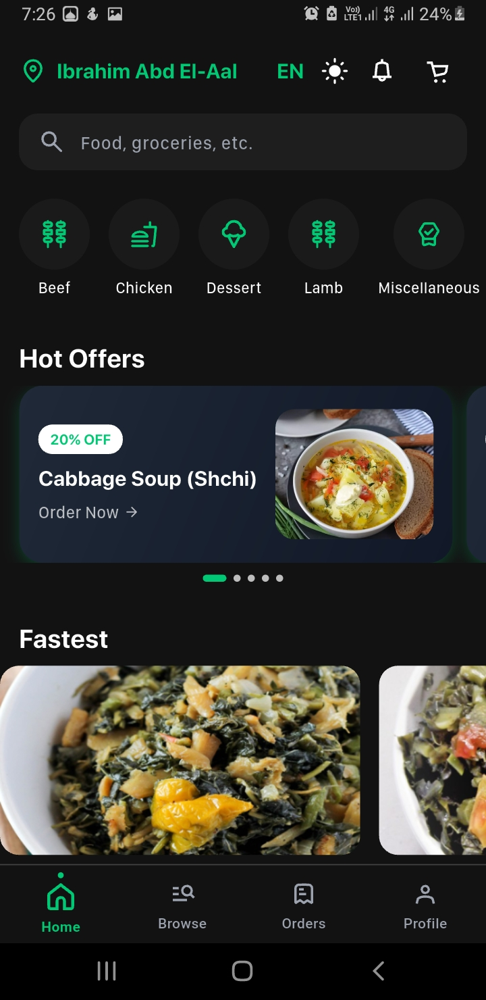
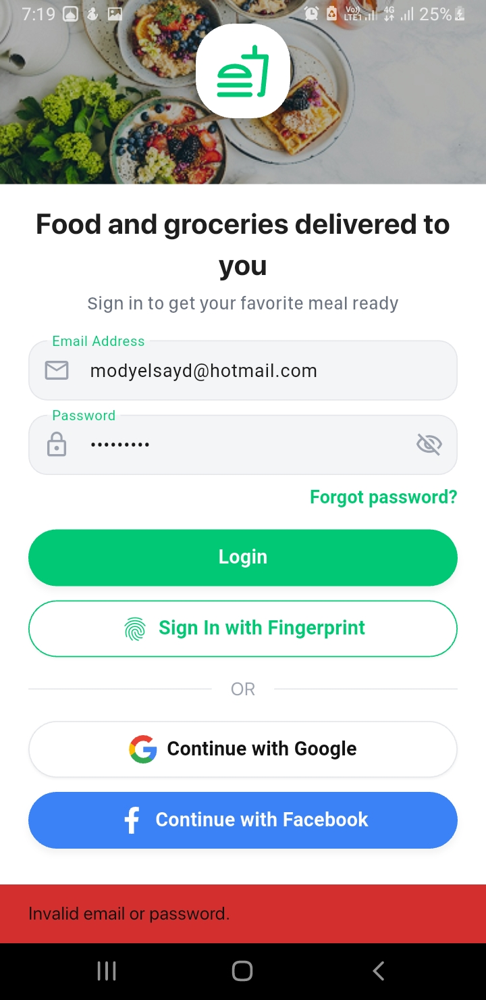
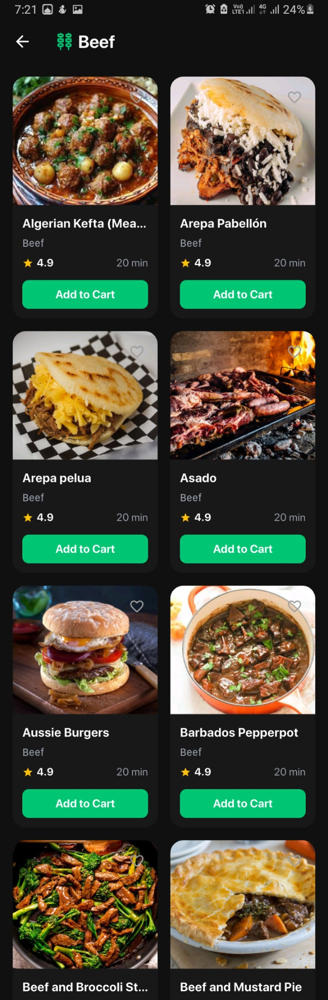
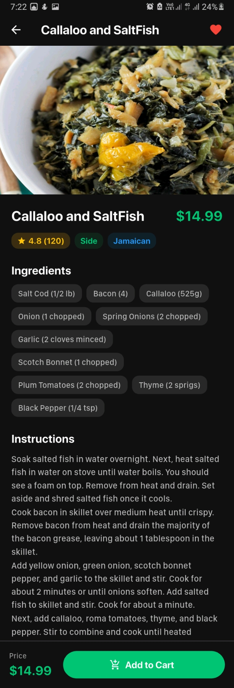
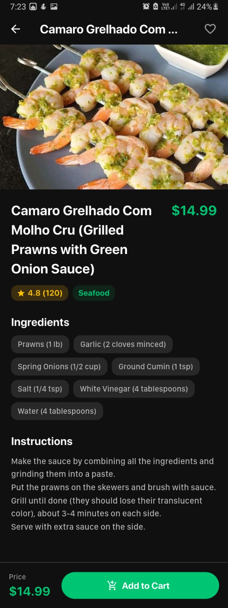

# 🍔 StreetBite V1.0 — Flutter Food Discovery & Ordering App

[](https://flutter.dev/)
[](https://firebase.google.com/)
[](https://bloclibrary.dev/)
[](LICENSE)

**StreetBite V1.0** is a production-grade, bilingual (English & Arabic) food discovery and ordering mobile application built with **Flutter**, **Clean Architecture**, **TheMealDB REST API**, and **Firebase Cloud Services**.

---

## 📸 App Screenshots Gallery

| Home Screen (Light) | Home Screen (Dark) | Category Meals |
| :---: | :---: | :---: |
|  |  |  |

| Cart & Checkout | Active & Past Orders | Favourites ❤️ |
| :---: | :---: | :---: |
|  |  |  |

| Profile & Settings | Vendor Map | App Tester |
| :---: | :---: | :---: |
|  |  |  |

---

## ✨ Features & Functionalities

### 🔐 1. Authentication & Security
- **Multi-Method Auth:** Email/Password Sign-In, Sign-Up, Google Sign-In, and Forgot Password email reset.
- **Persistent Sessions:** User session remains active across app restarts via Firebase Authentication.
- **Biometric Login (`local_auth`):** Fingerprint authentication explicitly bound to individual User UIDs in `SharedPreferences` for multi-account safety.

### 🍕 2. Live Menu & Food Discovery
- **TheMealDB API Integration:** Real-time fetching of 14 live categories, fastest meals, hot offers, and recommended food feeds via Dio HTTP client.
- **Meal Search & Filtering:** Live instant search by meal name, category filtering, and area/country filtering.

### 🚀 3. True Lazy Loading & Performance
- **Sliver Architecture:** `HomeScreen`, `CategoryMealsScreen`, and `OrdersScreen` utilize `CustomScrollView` and `Slivers` (`SliverGrid`, `SliverList`) for 100% true lazy loading.
- **RAM Image Optimization:** All remote image thumbnails use `CachedNetworkImage` with `memCacheWidth: 400` / `200` to prevent memory leaks or frame drops during fast scrolling.
- **Stale-While-Revalidate Caching:** Cached meals load instantly offline from `SharedPreferences` when network connectivity is lost.

### 🛒 4. Reactive Cart & Checkout
- **Real-Time Cart Calculation:** Dynamic Subtotal, Delivery Fee, Taxes, and Discount calculation via `CartCubit`.
- **GPS Location & Address Proximity:** Integrates `geolocator` and `geocoding` for live address fetching. Includes a **150-meter duplicate proximity check** to prevent duplicate addresses.
- **Extensible Payment Gateways (SOLID Strategy):** Checkout accepts Cash on Delivery and Saved Credit Cards using the Open/Closed Strategy Pattern.

### ⏱️ 5. Orders & Live Countdown
- **Dynamic Delivery Tracking:** Orders display an accurate 30-minute delivery countdown timer calculated from the exact `placedAtMillis` timestamp.
- **Automatic Transition:** Orders automatically transition from **Active Orders** (`Arrives in X min`) to **Past Orders** once the delivery window passes.

### ❤️ 6. Favourites & Cloud Persistence
- **Live Sync:** Heart icon buttons on meal cards and detail views synchronize favourite meals live with `users/{uid}/favourites` in Cloud Firestore.

### 🗺️ 7. Vendor Discovery Map
- **Google Maps (`google_maps_flutter`):** Interactive map displaying nearby food vendors with custom styled markers and InfoWindows showing ratings and cuisines.

### 🌐 8. Localization & Dark Theme
- **Bilingual Support (EN/AR):** Complete English and Arabic localization using ARB files with automatic RTL (Right-To-Left) layout mirroring.
- **Dynamic Light/Dark Mode:** Seamless app-wide theme switching preserved across sessions.

### 📱 9. Profile & Hardware Integration
- **Device Info (`device_info_plus`):** Displays user's specific device model and OS version.
- **Avatar Upload (`image_picker`):** Profile picture update from phone gallery uploaded to Firebase Storage.

---

## 🏗 Architecture & Design Patterns

The project follows **Clean Architecture** guidelines:

```
lib/
├── core/                  # Theme, Errors, Failures, UseCases
├── data/
│   ├── datasources/       # Remote (Dio/Firebase) & Local (SharedPreferences)
│   ├── models/            # JSON Models & Serializers
│   ├── repositories/      # Repository Implementations
│   └── services/          # Singleton & Payment Strategy Services
├── domain/
│   ├── entities/          # Pure Business Entities
│   ├── repositories/      # Repository Interfaces
│   └── usecases/          # Business Logic Use Cases
├── presentation/
│   ├── blocs/             # Cubits (Auth, Cart, Meal, Theme, Locale)
│   ├── screens/           # UI Screens (Home, Cart, Orders, Profile, etc.)
│   └── widgets/           # Reusable UI Components
├── l10n/                  # app_en.arb & app_ar.arb
└── injection.dart         # GetIt Service Locator Registration
```

### Documented Design Patterns
1. **Builder Pattern:** `UserModelBuilder` in `lib/data/models/user_model.dart` for step-by-step entity construction.
2. **Factory Pattern:** `MealDataSourceFactory` in `lib/data/repositories/meal_repository_impl.dart` for choosing between Local Cache and Remote API.
3. **Singleton Pattern:** `FirestoreService` in `lib/data/services/firestore_service.dart` for global database access.
4. **Strategy Pattern (SOLID):** `PaymentStrategy`, `CashPaymentService`, and `CardPaymentService` in `lib/data/services/payment_service.dart`.

---

## 🧪 Quality Assurance & Automation

- **Manual QA Suite:** Located in `docs/qa/` (Test Plan, Test Cases CSVs, Traceability Matrix, Test Closure Summary, Jira Bug Templates).
- **Appium Java Automation:** Located in `qa_automation/` (Maven project with TestNG, `BaseTest`, `LoginTest`, and `HomeTest` using W3C gesture actions).

---

## 🚀 Installation & Setup

1. **Clone the repository:**
   ```bash
   git clone https://github.com/mahmoudkhalaf93/StreetBite.git
   cd streetbite
   ```

2. **Install Flutter Dependencies:**
   ```bash
   flutter clean
   flutter pub get
   ```

3. **Run the App:**
   ```bash
   flutter run
   ```

4. **Build Release APK:**
   ```bash
   flutter build apk --release
   ```

---

## 👤 Developer & Acknowledgments

**Mahmoud Khalaf**  
*Senior Flutter Engineer & Software Architect*  
Graduation Capstone Project — **StreetBite V1.0**
