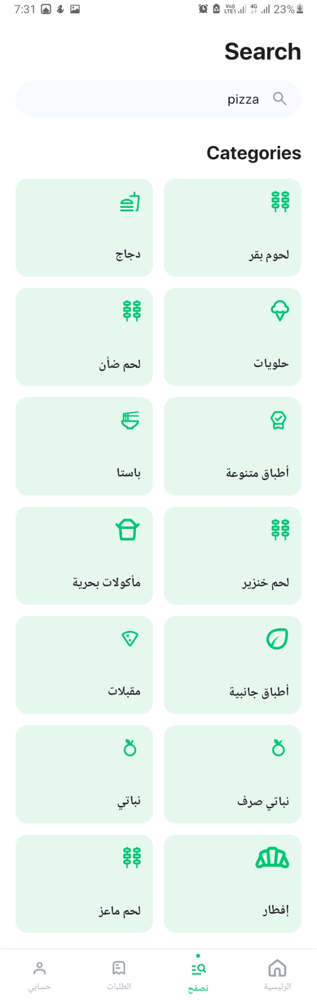
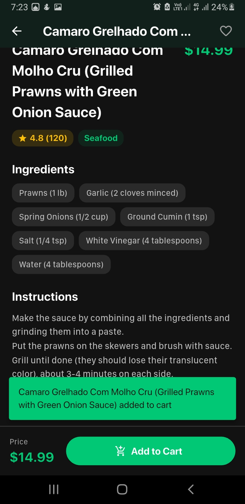
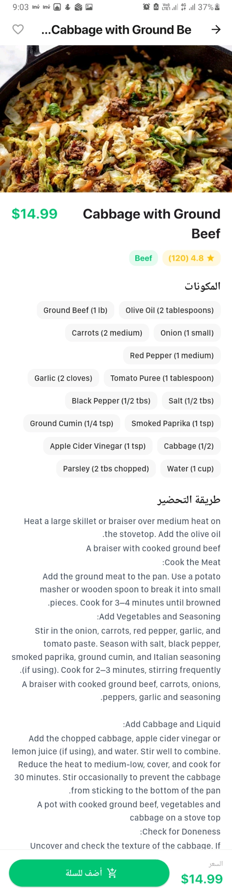
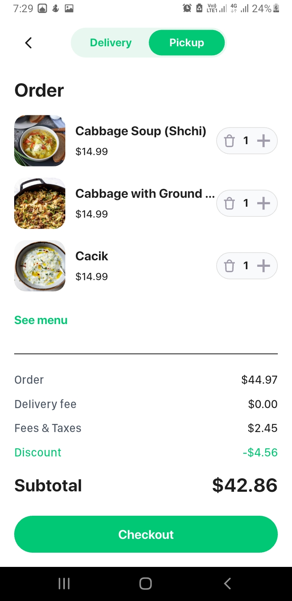
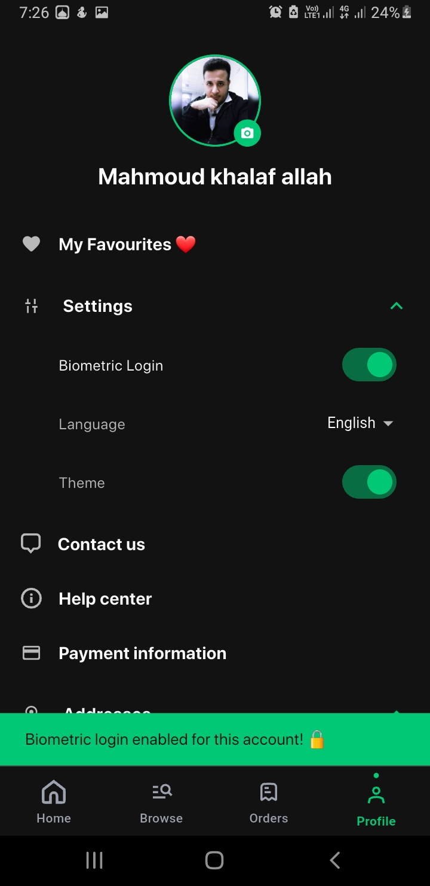

# 🍔 StreetBite V1.0 — Flutter Food Discovery & Ordering App

[](https://flutter.dev/)
[](https://firebase.google.com/)
[](https://bloclibrary.dev/)
[](LICENSE)

**StreetBite V1.0** is a full-featured, bilingual (English & Arabic) food discovery and ordering mobile application built with **Flutter**, **Clean Architecture**, **TheMealDB REST API**, and **Firebase Cloud Services**. Designed with responsive Material 3 principles, zero-lag lazy loading, and hardware integrations.

---

## 📱 Visual Showcase & App Screenshots

### 1. Home Screen & Food Feeds (EN, AR & Dark Mode)
> Dynamic header with geolocated address, auto-sliding banner offers with localized discount badges, categories carousel, fastest near you, and recommended meals grid with lazy loading.

<div align="center">

| Home Screen (Light) | Home Screen (Arabic RTL) | Home Screen (Dark Mode) |
| :---: | :---: | :---: |
|  |  |  |

</div>

---

### 2. Food Discovery, Search & Category Filtering
> Real-time search by dish or ingredient name, 14 live categories matching TheMealDB API, and country/area filtering (Italian, Egyptian, Asian, etc.).

<div align="center">

| Categories Grid | Meal Search (Pizza) | Category Filter (Beef Dark) |
| :---: | :---: | :---: |
|  |  |  |

</div>

---

### 3. Meal Details & Interactive Cart
> Full-resolution food imagery, rating badges, localized ingredients & instructions lists, quantity selectors, and instant cart additions.

<div align="center">

| Meal Details (English) | Meal Details (Arabic) | Interactive Cart |
| :---: | :---: | :---: |
|  |  |  |

</div>

---

### 4. Geolocated Checkout & Orders Countdown
> Checkout modal with 150m proximity duplicate address prevention, Cash/Card payment strategy, active 30-min live countdown timer, and automatic transition to past orders.

<div align="center">

| Checkout Modal (Arabic) | Active Orders (Countdown) | Past Orders History |
| :---: | :---: | :---: |
|  |  |  |

</div>

---

### 5. Profile, Biometric Security & Vendor Discovery Map
> User profile management, photo gallery upload to Firebase Storage, UID-bound fingerprint login toggle, device info display, and Google Maps vendor pins with custom InfoWindows.

<div align="center">

| Profile & Settings (Arabic) | Biometric Login Security | Google Maps Nearby Vendors |
| :---: | :---: | :---: |
|  |  |  |

</div>

---

## ⚡ Complete Feature Matrix & Architectural Capabilities

### 🔐 1. Authentication & Session Security
- **Multi-Factor Auth Flow:** Email/Password Authentication, Google Sign-In, Sign-Up with name validation, and Password Reset email link dispatch.
- **Persistent Session State:** Automatic auto-login session restoration via Firebase Auth.
- **Biometric Hardware Guard (`local_auth`):** Fingerprint/FaceID login capability stored securely per User `UID` in `SharedPreferences`.

### 🍕 2. Live REST API & Smart Caching
- **TheMealDB API Client:** Live HTTP fetching via `Dio` for 14 real API categories, random selection, and meal details.
- **Stale-While-Revalidate Caching:** Dual-layer local persistence via `SharedPreferences` allowing instant offline viewing of previously loaded meals.

### 🚀 3. True Lazy Loading & Memory Optimization
- **Sliver Grid Architecture:** `HomeScreen`, `CategoryMealsScreen`, and `OrdersScreen` use `CustomScrollView` and `Slivers` (`SliverGrid`, `SliverList`) for 100% lazy loading.
- **Image RAM Boundaries:** All remote network images use `CachedNetworkImage` with `memCacheWidth: 400` / `200` to prevent memory leaks or frame drops during fast scrolling.
- **Zero-Flicker Live Timers:** Order countdown timers update without rebuilding the main screen scaffold.

### 🛒 4. Reactive Cart & Geolocated Checkout
- **Dynamic Calculation Engine:** Real-time Subtotal, Delivery Fee, Taxes, and Discount calculation via `CartCubit`.
- **Address GPS & Proximity Check:** Integrates `geolocator` and `geocoding` for live location fetching with a **150-meter duplicate address check**.
- **SOLID Payment Gateways:** Checkout accepts Cash on Delivery and Saved Cards utilizing the Open/Closed Strategy Pattern (`PaymentStrategy`).

### ⏱️ 5. Orders Management & Live Countdown
- **Dynamic Order Classifier:** Orders calculate an exact 30-minute delivery window based on the `placedAtMillis` timestamp.
- **Automated Lifecycle:** Active orders automatically transition to **Past Orders** once the delivery time window elapses.

### ❤️ 6. Favourites & Cloud Synchronization
- **Firestore Persistence:** Heart toggles on cards and details screens sync live with `users/{uid}/favourites` in Cloud Firestore.

### 🗺️ 7. Vendor Discovery Map
- **Google Maps (`google_maps_flutter`):** Interactive map showing 5 nearby food vendor pins with custom InfoWindows displaying ratings and cuisines.

### 🌐 8. Localization & Dynamic Themes
- **Full EN/AR Localization:** Complete English and Arabic translations using ARB files with automatic RTL (Right-To-Left) layout mirroring.
- **Light/Dark Mode Engine:** Dynamic theme switching maintained globally across screens.

---

## 🏗 Architecture & Design Patterns

```
lib/
├── core/                  # Theme, Errors, Failures, UseCases
├── data/
│   ├── datasources/       # Remote (Dio/Firebase) & Local (SharedPreferences)
│   ├── models/            # JSON Models & Serializers
│   ├── repositories/      # Repository Implementations
│   └── services/          # Singleton & Payment Strategy Services
├── domain/
│   ├── entities/          # Pure Business Entities
│   ├── repositories/      # Repository Interfaces
│   └── usecases/          # Business Logic Use Cases
├── presentation/
│   ├── blocs/             # Cubits (Auth, Cart, Meal, Theme, Locale)
│   ├── screens/           # UI Screens (Home, Cart, Orders, Profile, etc.)
│   └── widgets/           # Reusable UI Components
├── l10n/                  # app_en.arb & app_ar.arb
└── injection.dart         # GetIt Service Locator Registration
```

### Documented Design Patterns
1. **Builder Pattern:** `UserModelBuilder` (`lib/data/models/user_model.dart`) for entity construction.
2. **Factory Pattern:** `MealDataSourceFactory` (`lib/data/repositories/meal_repository_impl.dart`) for remote vs. local cache switching.
3. **Singleton Pattern:** `FirestoreService` (`lib/data/services/firestore_service.dart`) for global database access.
4. **Strategy Pattern (SOLID):** `PaymentStrategy`, `CashPaymentService`, and `CardPaymentService` (`lib/data/services/payment_service.dart`).

---

## 🧪 Quality Assurance & Automation

- **Manual QA Documents:** Located in `docs/qa/` (Test Plan, Test Cases CSVs, Traceability Matrix, Test Closure Summary, Jira Bug Templates).
- **Appium Java Automation:** Located in `qa_automation/` (Maven project with TestNG, `BaseTest`, `LoginTest`, and `HomeTest` using W3C gesture actions).

---

## 🚀 Build & Installation

1. **Clone the repository:**
   ```bash
   git clone https://github.com/mahmoudkhalaf93/StreetBite.git
   cd streetbite
   ```

2. **Install Dependencies:**
   ```bash
   flutter clean
   flutter pub get
   ```

3. **Build Release APK:**
   ```bash
   flutter build apk --release
   ```

---

## 👤 Developer & Acknowledgments

**Mahmoud Khalaf**  
*Senior Flutter Engineer & Software Architect*  
Graduation Capstone Project — **StreetBite V1.0**
